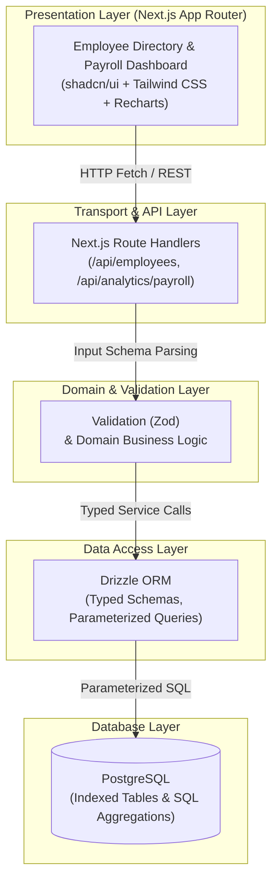

# System Architecture: ACME Employee Salary Management System

## Architectural Overview

The ACME Employee Salary Management System follows a layered, monolithic architecture built entirely within the Next.js App Router. This co-locates the user interface, API routing, business domain logic, and data access layers inside a single TypeScript project, eliminating microservice orchestration, external network hops, and multi-repo friction.

---

## Layer Responsibilities

### 1. Presentation Layer (Next.js UI)
- **Role:** Handles user interaction, client state, and responsive visual rendering.
- **Components:** Built with `shadcn/ui` primitives (Dialog, Button, Select, Table, Input) and styled with Tailwind CSS.
- **Data Visualization:** Employs `Recharts` for department and country compensation breakdowns.
- **Client State:** Manages active filters (country, department), search debounce, pagination state, and modal open/close states. Communicates with backend exclusively via standard JSON REST endpoints.

### 2. Transport & API Layer (Next.js Route Handlers)
- **Role:** Exposes typed RESTful HTTP endpoints (`/api/employees`, `/api/employees/[id]`, `/api/analytics/payroll`).
- **Responsibilities:**
  - Extracts HTTP request parameters (query strings, path parameters, JSON body).
  - Delegates input validation to the Domain Layer.
  - Formats standard HTTP response envelopes and status codes (`200 OK`, `201 Created`, `400 Bad Request`, `404 Not Found`, `500 Internal Server Error`).
  - Does **not** contain raw SQL or direct database calls.

### 3. Domain & Validation Layer (Zod & Business Services)
- **Role:** Enforces data integrity, business invariants, and calculation algorithms.
- **Responsibilities:**
  - Validates all incoming payloads using Zod schemas (e.g., verifying positive salary amounts, valid email formats, allowed country/currency pairings).
  - Houses pure domain services: employee filtering query construction, pagination offset/limit calculations, and payroll insight contracts.
  - Decoupled from Next.js request/response objects to enable fast, headless testing in Vitest.

### 4. Data Access Layer (Drizzle ORM)
- **Role:** Provides end-to-end type-safe database queries and migrations.
- **Responsibilities:**
  - Defines the single source of truth for the `employees` database table.
  - Executes parameterized SQL queries preventing SQL injection vulnerabilities.
  - Provides type-safe projection and filtering helpers without heavy runtime overhead.

### 5. Database Layer (PostgreSQL)
- **Role:** Persistent, transactional data store.
- **Responsibilities:**
  - Stores 10,000 employee records with high-precision decimal representation for salaries (`numeric(12, 2)`).
  - Utilizes B-tree indexes on `(country)`, `(department)`, and composite search indices to guarantee sub-second filter and pagination performance.
  - Executes server-side analytics aggregations (`COUNT`, `SUM`, `AVG`, and `percentile_cont(0.5) WITHIN GROUP (ORDER BY salary)` for exact median computation) directly in the database engine.
